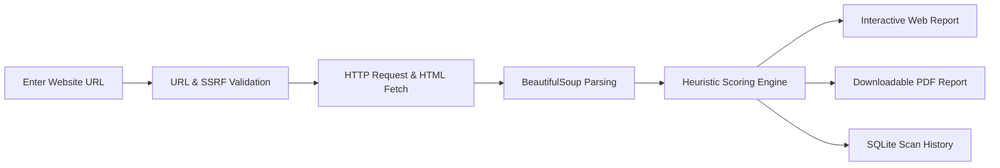

# 🌐 Website On-Page SEO Analyzer

[](https://website-on-page-seo-analyzer.onrender.com/)
[](https://www.python.org/)
[](https://flask.palletsprojects.com/)
[](https://gunicorn.org/)
[](LICENSE)

> 🚀 **Live Demo:** Try the application online without installation:  
> **[https://website-on-page-seo-analyzer.onrender.com/](https://website-on-page-seo-analyzer.onrender.com/)**

---

A full-stack Python & Flask application engineered to crawl, audit, and evaluate website on-page SEO health. It inspects metadata, content volume, heading structures, image accessibility, link distributions, and technical signals, scores pages out of 100, and generates instant downloadable PDF reports and SQLite audit histories.

---

## 📑 Table of Contents

- [🌟 Live Demo](#-live-demo)
- [✨ Key Features](#-key-features)
- [🔄 How It Works](#-how-it-works)
- [🛠️ Technology Stack](#️-technology-stack)
- [📁 Project Structure](#-project-structure)
- [⚙️ Getting Started Locally](#️-getting-started-locally)
  - [Prerequisites](#prerequisites)
  - [Windows Setup](#windows)
  - [macOS & Linux Setup](#macos--linux)
- [☁️ Deploying to Render](#️-deploying-to-render)
- [🧭 Application Routes](#-application-routes)
- [📐 Scoring Formula & Heuristics](#-scoring-formula--heuristics)
- [🛡️ Security Safeguards](#️-security-safeguards)
- [⚠️ Limitations & Production Notice](#️-limitations--production-notice)
- [📄 License](#-license)

---

## 🌟 Live Demo

The application is deployed and hosted on Render:

🔗 **[https://website-on-page-seo-analyzer.onrender.com/](https://website-on-page-seo-analyzer.onrender.com/)**

Simply enter any public website URL (e.g., `https://example.com`) along with an optional target keyword to trigger an immediate audit and download your report.

---

## ✨ Key Features

### 🔍 Comprehensive On-Page SEO Checks
- **Title Tag Audit**: Verifies `<title>` presence and optimal length (recommended 30–60 characters).
- **Meta Description Audit**: Verifies presence and optimal snippet length (recommended 120–160 characters).
- **Heading Hierarchy**: Inspects heading tags (`<h1>`–`<h6>`) and verifies that exactly one `<h1>` tag is present.
- **Image Accessibility**: Detects all `` elements and lists images lacking descriptive `alt` attributes.
- **Content Quality**: Evaluates clean extracted body word count against readable content benchmarks ($\ge$ 300 words).
- **Technical Signals**:
  - **HTTPS Protocol**: Checks secure transport layer enforcement.
  - **Canonical URL**: Detects `rel="canonical"` tags to guard against duplicate content penalties.
  - **Robots Directives**: Inspects meta robots directives (flags `noindex` blocks).
  - **Site Discoverability**: Tests network reachability for `/robots.txt` and `/sitemap.xml`.

### 🎯 Keyword Intelligence (Optional)
- Input an optional target keyword to measure:
  - Exact keyword occurrence count & keyword density percentage.
  - Presence across critical SEO real-estate: `<title>`, `<meta name="description">`, and `<h1>`.

### 🔗 Link Health & Sampling
- Counts internal vs. external links.
- Performs lightweight asynchronous sampling (up to 8 unique links) with short timeouts to detect broken links (`4xx`/`5xx`), redirects, and timeouts.

### 📊 Reports & Data Persistence
- **Interactive Dashboard**: Modern, responsive UI displaying scores, color-coded diagnostic badges, and actionable fix recommendations.
- **Dynamic PDF Reports**: Generates professional, styled A4 audit reports via ReportLab directly in-memory for immediate download.
- **Historical Scan Logging**: Automatically records previous audit runs in SQLite with timestamps and scores for tracking changes over time.

### 🛡️ Security by Design
- **SSRF Mitigation**: Resolves hostnames via DNS and blocks requests targeting private, loopback, or internal IP ranges (`127.0.0.1`, `10.x`, `192.168.x`).
- **Response Guard**: Imposes strict 3 MB payload caps and request timeouts to protect server resources.
- **Zero Disk Waste**: Generates PDF reports in `io.BytesIO` streams without leaving temporary files on disk.

---

## 🔄 How It Works



---

## 🛠️ Technology Stack

| Layer | Technologies |
| :--- | :--- |
| **Backend** | Python 3.10+, Flask 3.0+ |
| **WSGI Server** | Gunicorn |
| **Web Scraping & Parsing** | Requests, BeautifulSoup4 |
| **PDF Generation** | ReportLab |
| **Database** | SQLite3 |
| **Frontend** | HTML5, Vanilla CSS3 (Custom Responsive Design System), Vanilla JavaScript |
| **Cloud Hosting** | [Render](https://render.com) |

---

## 📁 Project Structure

```text
Website_On_Page_SEO_Analyzer/
├── app.py                  # Core Flask application (crawler, scoring engine, routes & PDF exporter)
├── requirements.txt        # Production Python dependencies
├── README.md               # Project documentation and deployment guide
├── .gitignore              # Git ignore rules for environments, databases, and caches
├── static/
│   └── style.css           # Custom responsive styles, badges, and dashboard layout
└── templates/
    ├── index.html          # Main audit interface and report viewer
    └── history.html        # Scan history listing and past audit inspector
```

---

## ⚙️ Getting Started Locally

### Prerequisites
- **Python 3.10 or higher** installed on your system.

---

### Windows

1. **Clone the repository:**
   ```powershell
   git clone https://github.com/Bhavish4/Website-On-Page-SEO-Analyzer.git
   cd Website-On-Page-SEO-Analyzer
   ```

2. **Create and activate a virtual environment:**
   ```powershell
   python -m venv .venv
   .\.venv\Scripts\Activate.ps1
   ```
   *(If PowerShell script execution is restricted, run: `Set-ExecutionPolicy -Scope Process -ExecutionPolicy Bypass`)*

3. **Install dependencies:**
   ```powershell
   pip install -r requirements.txt
   ```

4. **Run the application:**
   ```powershell
   python app.py
   ```

5. **Visit the app:**  
   Open your browser and navigate to `http://127.0.0.1:5000`.

---

### macOS & Linux

1. **Clone the repository:**
   ```bash
   git clone https://github.com/Bhavish4/Website-On-Page-SEO-Analyzer.git
   cd Website-On-Page-SEO-Analyzer
   ```

2. **Create and activate a virtual environment:**
   ```bash
   python3 -m venv .venv
   source .venv/bin/activate
   ```

3. **Install dependencies:**
   ```bash
   pip install -r requirements.txt
   ```

4. **Run the application:**
   ```bash
   python app.py
   ```

5. **Visit the app:**  
   Open your browser and navigate to `http://127.0.0.1:5000`.

---

## ☁️ Deploying to Render

This project is pre-configured for seamless deployment as a **Web Service** on [Render](https://render.com):

1. **Create a New Web Service** on Render and connect your GitHub repository:
   ```
   https://github.com/Bhavish4/Website-On-Page-SEO-Analyzer
   ```

2. **Configure Settings:**
   - **Environment:** `Python 3`
   - **Build Command:**
     ```bash
     pip install -r requirements.txt
     ```
   - **Start Command:**
     ```bash
     gunicorn app:app
     ```

3. **Environment Variables (Optional):**
   - `SECRET_KEY`: Set a secure random string for session handling.

4. **Deploy:** Render will build and deploy the service automatically.

---

## 🧭 Application Routes

| Endpoint | Method | Description |
| :--- | :---: | :--- |
| `/` | `GET`, `POST` | Audit form, on-page score calculation, and diagnostic results |
| `/history` | `GET` | Database listing of past scan results |
| `/history/<scan_id>` | `GET` | View a saved historical audit |
| `/history/delete/<scan_id>` | `POST` | Delete an audit record from the database |
| `/history/clear` | `POST` | Clear all historical audit records |
| `/report/<scan_id>.pdf` | `GET` | Stream dynamic A4 PDF audit summary |

---

## 📐 Scoring Formula & Heuristics

The overall SEO score (0–100) is calculated based on weighted pass/fail checks:

| Check | Weight | Passing Criteria |
| :--- | :---: | :--- |
| **Title Tag Exists** | 2 | `<title>` tag is present in HTML head |
| **Title Tag Length** | 2 | Length is between 30 and 60 characters |
| **Meta Description Exists** | 2 | `<meta name="description">` is present |
| **Meta Description Length** | 1 | Length is between 120 and 160 characters |
| **Single H1 Heading** | 2 | Exactly one `<h1>` heading exists on the page |
| **Image Alt Attributes** | 2 | All detected `` elements include non-empty `alt` attributes |
| **Content Volume** | 1 | Clean body text contains 300 or more words |
| **Canonical URL** | 1 | `<link rel="canonical">` is specified |
| **Indexing Directive** | 2 | Robots directive does not contain `noindex` |
| **Internal Links** | 1 | At least 3 internal links detected |
| **External Links** | 1 | At least 1 outbound link detected |
| **HTTPS Protocol** | 1 | Page is served securely over HTTPS |
| **Keyword in Title** *(optional)* | 1 | Target keyword appears in `<title>` |
| **Keyword in Description** *(optional)* | 1 | Target keyword appears in meta description |
| **Keyword in H1** *(optional)* | 1 | Target keyword appears in `<h1>` |

$$\text{Final Score} = \text{round}\left(100 \times \frac{\sum \text{Passed Check Weights}}{\sum \text{Total Applicable Weights}}\right)$$

---

## 🛡️ Security Safeguards

- **SSRF Defense**: Strict validation resolves hostnames to public IPv4/IPv6 addresses, rejecting private network and localhost access (`127.0.0.1`, `10.0.0.0/8`, `192.168.0.0/16`, `.local`).
- **Resource Constraints**: Maximum response payload of 3 MB and 8-second request timeouts prevent Denial-of-Service (DoS) and memory exhaustion.
- **In-Memory Streaming**: PDF reports are rendered and streamed directly via `BytesIO`, avoiding server-side file leakage or orphan files.

---

## ⚠️ Limitations & Production Notice

- **Heuristic Estimates**: Scores are based on common on-page SEO best practices and do not guarantee search engine rankings.
- **Client-Side SPAs**: Pages rendered solely via client-side JavaScript (e.g., non-SSR React/Vue) may not have their dynamic DOM exposed to static HTML parsers.
- **WAF & Bot Blockers**: Target sites utilizing aggressive WAFs (e.g., Cloudflare, Akamai) might return `403 Forbidden` or CAPTCHAs to automated requests.
- **Database Persistence**: Render free tier instances use ephemeral storage; for persistent long-term SQLite records across restarts, attach a Render Persistent Disk or configure an external database.

---

## 📄 License

This project is licensed under the [MIT License](LICENSE).
